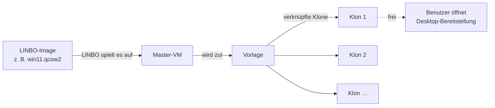

# Virtuelle Desktops auf dem Schulserver einrichten

Die virtuellen Desktops, die Lernende in der App **Desktop-Bereitstellung** öffnen, laufen als virtuelle Maschinen auf einem Proxmox-Server. Verwaltet werden sie vom Dienst **edulution-linbo-vdi** auf dem Linuxmuster-Server. Er baut aus einem gewöhnlichen LINBO-Image eine Vorlage, hält davon stets einige startbereite Kopien vor und teilt sie den Benutzern zu.

Diese Seiten führen Sie durch die Einrichtung. Wie die App in der Plattform angebunden wird, steht unter [Konfiguration](../konfiguration/index.md); wie Benutzer sie bedienen, in der [Übersicht](../index.md).

## So arbeitet der Dienst

1. **Master bauen.** Für jede VDI-Gruppe legt der Dienst eine virtuelle Maschine an, lässt sie über das Netzwerk in LINBO starten und das Image aufspielen – genau wie einen physischen Rechner. Sobald das Betriebssystem antwortet, wird die Maschine heruntergefahren und zur **Vorlage** umgewandelt.
2. **Klone vorhalten.** Von der Vorlage erzeugt der Dienst *verknüpfte Klone*. Sie belegen fast keinen Speicher, sind in Sekunden angelegt und in wenigen Minuten gestartet. Wie viele es sein sollen, legen Sie fest: eine Untergrenze, eine Obergrenze und wie viele davon stets unbenutzt bereitstehen sollen.
3. **Desktops zuteilen.** Fordert jemand in der App einen Desktop an, bekommt er einen freien Klon. Der Klon bleibt ihm vorbehalten, solange er dort angemeldet ist.
4. **Aufräumen.** Ein Klon, dessen Sitzung beendet ist, wird gelöscht und neu aus der Vorlage erzeugt. So findet niemand die Daten des Vorgängers vor. Ändern Sie das Image oder die Ausstattung der Maschinen, baut der Dienst Vorlage und Klone von selbst neu.

:::info[Was Sie nicht tun müssen]
Sie legen keine virtuellen Maschinen von Hand an und löschen auch keine. Der Dienst erzeugt, startet, ersetzt und entfernt Master und Klone selbst. Ihre Aufgabe ist es, ihm zu sagen, *was* er bauen soll: welches Image, welche Ausstattung, wie viele Klone.
:::

## Was Sie brauchen

| Baustein | Anforderung |
|----------|-------------|
| Linuxmuster-Server | Version 7.2 oder neuer, Ubuntu 22.04, 24.04 oder 26.04 |
| Proxmox VE | Version 8 oder 9, ein Server (Node). Darauf ein Speicher, der Momentaufnahmen beherrscht (ZFS, LVM-Thin oder Ceph) – verknüpfte Klone brauchen das |
| Netzwerk | Die virtuellen Maschinen müssen den Linuxmuster-Server erreichen (LINBO-Start über das Netzwerk, Anmeldung). Der Server muss den Proxmox-Server auf Port 8006 erreichen |
| Image | Ein LINBO-Image des gewünschten Betriebssystems, vorbereitet wie in [Image vorbereiten](image-vorbereiten.md) beschrieben |
| Plattform | edulution mit linuxmuster-api ab 7.4.20 und der App **Desktop-Bereitstellung** ([App einrichten](../konfiguration/app-einrichten.md)) |

## Ablauf

| Schritt | Seite | Dauer |
|---------|-------|-------|
| 1. Proxmox vorbereiten: Benutzer, Zugriffsrechte, Speicher, Netzwerk | [Proxmox vorbereiten](proxmox-vorbereiten.md) | 15 Minuten |
| 2. Paket installieren und den Einrichtungsassistenten durchlaufen | [Installation](installation.md) | 15 Minuten |
| 3. Image vorbereiten und hochladen | [Image vorbereiten](image-vorbereiten.md) | je nach Image |
| 4. Dienst starten und zusehen, wie Master und Klone entstehen | [Betrieb und Fehlersuche](betrieb.md) | 20 bis 40 Minuten Wartezeit |

Alle Einstellungen im Detail stehen im [Nachschlagewerk](referenz.md).
